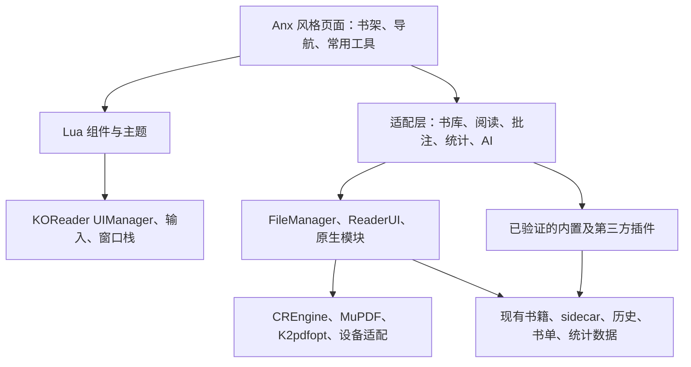

# KOReader 保留阅读能力、引入 Anx 风格的实施方案

编写日期：2026-10-29。修订：v2，面向 AI 实施。状态：实施中；实际代码进度、已验证范围和未测项见执行记录。

AI 从[执行入口](ai-execution.zh-CN.md)开始，再按[执行批次](tasks.zh-CN.md)实施，并把状态写入[执行记录](execution-state.json)。[验收矩阵](acceptance.zh-CN.md)定义功能与发布质量。

本文件负责产品目标与技术边界；执行入口负责流程，批次表负责可改范围和交付，JSON 只记录事实与进度。用户后续指令优先；记录与源码冲突时先核实，不能只依据旧状态跳过检查。

## 1. 推荐决策

以 /data/koreader 为主工程，继续使用其 Lua UI、阅读模块、文档引擎、设备适配和插件系统。新增一个暂名为 **anxui.koplugin** 的界面插件，采用 Anx 的书架布局、导航结构、卡片样式和信息层次；通过适配层调用 KOReader 已有业务能力。

优先以插件完成开发。只有在真实原型证明插件接口不足时，才向核心增加默认关闭、可独立回退的扩展点。Anx 的 Flutter 页面、Riverpod 状态和 SQLite 数据结构不直接搬入本工程。

首版围绕一个闭环交付：**进入新书架 → 打开原有书籍 → 使用原阅读能力 → 保存批注与进度 → 返回新书架 → 切回原界面后数据仍然有效**。

“保留大部分功能”的具体含义：目标设备上原本可用的关键阅读能力全部通过回归；常用功能进入新界面；未改造的高级功能仍可从原生菜单访问。新界面不以隐藏入口的方式宣称完成兼容。

## 2. 规划假设与范围

当前尚未指定首发设备型号，以下默认值可直接用于开始本地开发。缺少实机型号只影响对应设备验证，不阻塞 Linux 原型和独立功能的开发：

| 项目 | 本方案默认值 | 确认节点 |
| --- | --- | --- |
| 首发使用平台 | Android 彩屏 | G0 |
| 开发、自动化和宽屏验证 | Linux SDL 环境 | G0 |
| 墨水屏 | 接入实机后验证；没有实机时记录待验证，不宣称已支持 | 外部验证批次 W37 |
| 首发语言 | 简体中文、英文；保留 gettext 接口和 RTL 扩展能力 | G1 |
| 外观目标 | 常用页面接近 Anx，保留 KOReader 的高级原生菜单 | G1 |
| 首版 AI | 可选接入已验证版本的 KOAssistant，先使用其现有对话窗口；缺少服务凭据时先验证不可用分支 | G4、W38 |
| 发布目标 | 自用预览版 → 指定设备测试版 → 可持续维护的定制版 | 各阶段 |

Windows、iOS 和完整 macOS 产品适配需要另外立项。更换 Lua 界面不会自动增加 KOReader 的平台支持。

### 2.1 纳入 v1

- Anx 风格首页、封面网格/列表、搜索、最近阅读、收藏/书单、基础排序。
- 底部导航与宽屏侧栏；新界面中的一致返回行为。
- 阅读页的顶部/底部工具栏、常用设置、目录和笔记入口。
- 对原 EPUB、PDF/DjVu、图片/漫画阅读能力的保留与验证。
- 笔记浏览、筛选、定位和现有导出能力的接入。
- 阅读统计概览；保留原统计详情页。
- 可选 AI 选段解释、翻译和摘要入口。
- 彩屏、灰度墨水屏和彩色墨水屏的显示策略。
- 插件兼容检查、经典界面回退、版本锁定及升级流程。

### 2.2 后续扩展，分别估算

| 项目 | 延后原因 | 后续进入条件 |
| --- | --- | --- |
| Anx 与 KOReader 书库/笔记双向同步 | 两套身份、定位和冲突处理模型不同 | 独立迁移/同步规范与样本测试 |
| 全文双语对照排版 | 涉及内容与排版行为，超出 UI 层 | 原型验证批注锚点、进度和搜索 |
| 多平台 TTS、后台播放、逐句高亮 | 设备音频能力和文本定位差异大 | 明确目标设备及音频后端 |
| 全部第三方插件统一皮肤 | 插件常自带窗口和布局 | 逐个版本适配清单 |
| 实时毛玻璃、复杂封面转场 | 需要额外绘制和性能优化 | 基础交互与内存指标达标 |
| 全书 AI 检索、自动整理书库 | 不只是增加对话窗口 | 明确数据来源、写入规则和检索方案 |

## 3. 已核实的工程基线

| 项目 | 本地状态 | 对方案的影响 |
| --- | --- | --- |
| KOReader | 提交 dcb50ae439f2，2026-10-28 | 作为第一轮基线，后续升级需复测 |
| Anx Reader | 提交 0c7fc1ad4551，2026-10-17，v1.15.0-alpha.35 | 作为外观和交互参考 |
| KOReader 原生依赖 | 编写时 base、字体、翻译、Android launcher、测试数据子模块未初始化 | W00 重新探测，W01 先建立 Linux 可运行基线 |
| 内置插件 | 37 个 .koplugin 目录，含 hello 调试示例 | 不能把目录数量直接等同于用户功能数量 |
| 第三方插件 | 已核对作者文档，尚未安装测试 | 仅列为候选依赖 |

关键代码依据：

| 已存在的代码 | 已确认的职责 | 计划接入方式 |
| --- | --- | --- |
| [pluginloader.lua](../../frontend/pluginloader.lua) | 插件发现、实例化、禁用和生命周期管理 | 新 UI 注册为普通插件；按能力检查第三方插件 |
| [filemanager.lua](../../frontend/apps/filemanager/filemanager.lua) | 文件浏览、历史、书单、插件加载、打开书籍 | 复用数据和操作入口，附加新的首页视图 |
| [readerui.lua](../../frontend/apps/reader/readerui.lua) | 阅读模块组装与打开/关闭文档 | 保持会话和文档生命周期由原模块管理 |
| [dispatcher.lua](../../frontend/dispatcher.lua) | 操作注册、条件检查、事件分发 | 新按钮复用已注册动作；需要参数的操作由适配器调用 |
| [uimanager.lua](../../frontend/ui/uimanager.lua) | 窗口栈、事件、脏区和刷新调度 | 新页面使用原管理器，避免另建事件循环 |
| [framecontainer.lua](../../frontend/ui/widget/container/framecontainer.lua) | 边框、圆角、彩色背景 | 构建卡片、搜索框和导航组件 |
| [imagewidget.lua](../../frontend/ui/widget/imagewidget.lua) | 图像、缩放、透明混合 | 封面、图标和缓存背景 |
| [coverbrowser](../../plugins/coverbrowser.koplugin/main.lua) | 封面和元数据缓存、浏览显示方式 | 封面适配器优先复用；缺失时可用文本占位 |
| [docsettings.lua](../../frontend/docsettings.lua) | 单书配置与 sidecar 位置 | 保留原始阅读状态和批注存储 |
| [datastorage.lua](../../datastorage.lua) | 各平台数据和设置目录 | 所有新数据路径通过此模块获取 |

已有章节内容接口和 Flutter 页面可以帮助理解 Anx 的行为，但不会成为本项目运行依赖。参考文件位于 /data/anx-reader/lib/page/home_page.dart、lib/page/reading_page.dart、lib/widgets/bookshelf/ 和 lib/providers/chapter_content_bridge.dart。

## 4. 架构与改动边界



### 4.1 四层责任

1. **页面层**负责展示、局部状态和导航，不直接写 sidecar、统计数据库或调用底层排版引擎。
2. **组件层**负责颜色、字形、尺寸、焦点、交互反馈和布局；参数按设备显示模式转换。
3. **适配层**负责把新界面操作映射到现有 KOReader 模块；集中处理版本差异与插件缺失。
4. **KOReader 原有模块**负责文档状态、选字、批注、阅读进度、同步、渲染和硬件事件。

以下是计划新增的内部接口，不是 KOReader 现有 API：

| 拟新增适配器 | 提供给页面的能力 | 底层数据/执行方 |
| --- | --- | --- |
| LibraryAdapter | 分页列书、筛选、获取封面、书籍详情、打开 | 文件系统、ReadHistory、ReadCollection、BookInfoManager、FileManager |
| ReaderAdapter | 当前文档快照、执行阅读动作、显示原生高级菜单 | ReaderUI、Dispatcher、阅读子模块 |
| AnnotationAdapter | 列出笔记、定位原文、编辑/删除、导出 | ReaderAnnotation、ReaderBookmark、Exporter；仅适配已验证操作 |
| StatisticsAdapter | 今日/本周概览、打开原统计页 | statistics 插件；禁用时返回不可用状态 |
| AIAdapter | 能力查询、以选区启动动作、打开助手 | 版本锁定的 KOAssistant；接口未核实时使用原生入口 |
| CapabilityAdapter | 检查设备、触摸、键盘、插件及功能状态 | Device、PluginLoader、运行时实例 |

所有适配器返回明确的成功、不可用、过期会话和错误状态。页面按能力显示入口，不能在点击后才因缺少插件崩溃。

### 4.2 推荐目录

```text
plugins/anxui.koplugin/
  _meta.lua
  main.lua                 # 插件入口，轻量加载、实例生命周期
  settings.lua             # 仅保存新 UI 自身设置
  lifecycle.lua            # 绑定、解绑、取消后台任务、释放封面
  navigation.lua           # 新 UI 内部路由，原窗口栈仍由 UIManager 管理
  theme.lua                # 颜色、尺寸、字体与显示模式
  capabilities.lua
  compat/
    core.lua
    coverbrowser.lua
    statistics.lua
    koassistant.lua
  adapters/
    library.lua
    reader.lua
    annotations.lua
  views/
    home.lua
    book_detail.lua
    reader_toolbar.lua
    notes.lua
    statistics.lua
    settings.lua
  widgets/
    book_card.lua
    search_field.lua
    navigation_bar.lua
    action_sheet.lua
    empty_state.lua
  assets/icons/
spec/unit/anxui_*_spec.lua
doc/anx-style-ui/
```

上述目录是目标结构，按批次逐步增加文件，不以目录存在推断功能已实现。模块加载使用明确命名空间或插件实际路径，避免与其他插件的 main、settings、theme 等名称发生冲突。

### 4.3 核心扩展点的控制

先尝试普通插件、已有事件和 post-init 回调。FileManager 的 post-init 发生在 instance 赋值与 UIManager:show 之前，不能在回调里假设顶层窗口已经可见；应在 Show 后或下一次事件循环核实当前实例再附加界面。

如需核心补丁，限定为有说明、有回归的扩展接口，例如“文件管理器显示后允许注册一个替代首页”或“阅读工具栏注册入口”。具体调用位置由 P0 原型确定。扩展缺失、插件禁用或初始化失败时，原始路径继续执行。

禁止在绘制回调中修改全局 Size、字体或菜单类；不大范围覆盖 FileManager、ReaderUI、UIManager 方法。已有插件确有方法替换行为，必须在兼容审计中逐项记录，不能假设所有插件都只用稳定 API。

## 5. 第三方插件的复用策略

默认采用一个新 UI 作为首页和导航的唯一管理方。SimpleUI、Bookshelf 先用于功能对照与原型评估，不作为两个同时接管首页的强制依赖。

| 候选 | 已核对的公开能力 | 本项目的处理 |
| --- | --- | --- |
| [SimpleUI](https://github.com/doctorhetfield-cmd/simpleui.koplugin) | 首页、导航栏、顶部栏和组件面板 | 参考布局与模块划分；P0 审计全局改写和生命周期 |
| [Bookshelf](https://github.com/AndyHazz/bookshelf.koplugin) | 书架展示、分类和详情 | 对照书架体验；是否复用局部实现由依赖成本决定 |
| [Bookshelf Source API](https://github.com/AndyHazz/bookshelf.koplugin/blob/master/SOURCE_API.md) | 为 Bookshelf 注册书源 | 这是书源扩展接口，不能据此假设可以直接替换其 UI |
| [KOAssistant](https://github.com/zeeyado/koassistant.koplugin) | 阅读 AI 交互 | 优先调用原入口，后续核实可适配接口；不在首版重写模型客户端 |
| [KOReader contrib](https://github.com/koreader/contrib) | 非官方插件集合 | 用于发现候选；集合中明确说明升级后可能失效 |

采用插件前记录来源、许可证、完整提交号、发行包校验值、最低 KOReader 版本和实际测试结果。KOAssistant 审计放在 W26；SimpleUI、Bookshelf 的可选调研不作为 G0 前置条件。发布包不直接追踪第三方 main/master 最新分支。

默认路线固定为 anxui 独立插件，AI 不需要在每批次重新比较路线。只有发现可复现的插件接入限制，并证明局部核心扩展仍无法解决时，才记录替代方案及影响；涉及改用 Flutter、改变阅读引擎或扩大跨平台目标的决定需要用户明确变更目标。常规局部接口适配由 AI 根据证据继续完成。

## 6. 视觉与交互规范

### 6.1 设计基准

以 Anx 本地书架截图和当前源码为参考，提取可验收的尺寸、间距、字重、颜色与交互规则。先冻结四类参考画面：竖屏书架、宽屏书架、阅读工具栏、笔记列表。截图中带有手机外框的宣传图只作为设计参考，不作为像素差分基线。

初始主题参数以 KOReader 的逻辑尺寸表示，全部通过 Screen:scaleBySize 或等价设备缩放接口转换：

| 项目 | 初始设计值 | 约束 |
| --- | --- | --- |
| 间距 | 4、8、12、16、24 | 不在页面散落固定物理像素 |
| 卡片圆角 | 8–12 | 墨水屏可采用更小圆角或方角 |
| 点击区 | 约 44–48 逻辑单位起 | 以实机触摸可用性校正 |
| 书架封面 | 保留原比例；固定网格单元 | 无封面、长标题、缺作者均有占位 |
| 导航 | 窄屏底部、宽屏侧栏 | 根据可用逻辑宽度，不根据设备名称硬编码 |
| 窄/宽切换 | 以 720 逻辑单位作为原型起点 | G1 根据字号和实机调整并冻结 |
| 字号 | 统一正文、次要信息、标题三级 | 简中、英文、长词和大字模式验收 |

### 6.2 显示模式

| 模式 | 视觉策略 | 刷新策略 |
| --- | --- | --- |
| 彩屏 | 主题色、轻量阴影、彩色封面 | 允许经过测量的短反馈；不预设必须实现复杂转场 |
| 灰度墨水屏 | 高对比、清晰边框、选中图标/文字双提示 | 复用 UIManager 的局部与全刷策略；默认关闭连续动画 |
| 彩色墨水屏 | 少量强调色，灰度下仍可分辨 | 仍按墨水屏处理刷新与残影 |

模式由设备能力给默认值，同时提供用户覆盖。Android 墨水屏设备不能只因运行 Android 就归入彩屏模式。

### 6.3 页面与行为

| 页面 | 首版行为 | 保留入口 |
| --- | --- | --- |
| 书架 | 搜索栏、封面网格/列表、最近/全部/收藏、排序、继续阅读 | 原文件浏览器、文件操作 |
| 书籍详情 | 封面、书名、作者、进度、书单、打开、原生更多操作 | 元数据详情、原文件菜单及插件附加动作 |
| 阅读页 | 按需显示工具栏；目录、进度、样式、笔记、词典、AI、更多 | KOReader 完整菜单、PDF 专属选项 |
| 笔记 | 当前书优先；按时间/章节/类型筛选，点击定位 | 原批注编辑与导出窗口 |
| 统计 | 今日/本周时长等摘要卡片 | 原统计日历和详情 |
| 设置 | 外观、阅读、设备、同步、插件、AI 的分组入口 | 原设置搜索和高级菜单 |

首页不长期持有已经关闭的 FileManager 或 ReaderUI 实例。界面打开书籍时清理自己的弹窗与焦点，再走 FileManager/openFile 或 ReaderUI/showReader 的现有流程，避免直接 new ReaderUI 产生双实例。

返回键按“当前弹窗 → 当前子页面 → 当前首页/阅读上下文”的顺序处理。阅读中的返回行为尊重 KOReader 原设置；新增的明确“书架”按钮才执行回书架，避免把所有 Back 改成退出阅读。硬件翻页键、菜单键和现有边缘手势保留。

### 6.4 视觉统一程度

- V0：新页面统一主题，原生高级窗口维持原样，功能可达。
- V1：改造高频目录、批注入口、常用样式面板，统一视觉与返回路径。
- V2：按白名单适配第三方窗口；不把 V2 作为首版完成的前置条件。

AI 面板首版是明确入口加原助手窗口。持续并排的聊天侧栏、富文本图表和实时流式排版属于后续 UI 工作，不能把“入口已接入”表述成“Anx AI 页面已复刻”。

## 7. 数据、状态与任务调度

### 7.1 数据的唯一写入方

| 数据 | 权威来源 | 新 UI 允许做什么 |
| --- | --- | --- |
| 书籍文件 | 现有文件与 FileManager 操作 | 索引和展示；移动/重命名通过原操作 |
| 阅读位置、单书排版、批注 | ReaderUI 模块及 DocSettings | 读取快照；调用原模块写入 |
| 历史、收藏/书单 | ReadHistory、ReadCollection | 通过原接口读写 |
| 阅读统计 | statistics 插件及其数据库 | 读取接口或只读适配；不另起计时器 |
| AI 凭据、对话 | 所选 AI 插件 | 复用其管理方式，不复制到 UI 设置 |
| UI 外观与布局 | 新 UI 自身设置 | 独立版本化存储 |
| 封面/列表缓存 | 原缓存及新 UI 可重建缓存 | 允许删除重建，不作为用户数据来源 |

新 UI 设置放入 DataStorage:getSettingsDir() 下的 anxui 命名空间；派生缓存放入 DataStorage:getDataDir() 下的独立缓存目录。实际存储格式和 schema_version 在 P1 确定。配置写入采用既有设置设施和可回滚迁移，不直接覆盖用户全部 settings.reader.lua。

### 7.2 定位与书籍身份

- EPUB 保留 KOReader 的 xpointer/DOM 版本信息，CFI 用于已验证的互操作场景。
- PDF/DjVu 保留页码、框选区域和重排所需原始信息，不强转成 EPUB 定位。
- 全局笔记页是可重建索引；当前打开书籍的未落盘状态从活跃 ReaderUI 读取。
- UI 缓存以规范化路径和文件修改信息校验有效性；它不是跨设备永久书籍 ID。
- 文件移动、替换和重命名跟随原模块处理，按操作结果失效缓存；不自行迁移或合并 sidecar。
- 暂不把 Anx 数据库导入作为默认启动步骤；需要时独立提供预览、备份和重复记录处理方案。

### 7.3 大书库、后台工作和异步结果

- 首屏只读取当前视口与小量预取范围的元数据；封面未就绪先显示占位。
- 搜索、排序优先使用索引；1,000 本为标准验收规模，5,000 本为压力规模。
- Lua 定时回调只是分片调度，不会把阻塞 I/O 自动变为异步。目录扫描分批让出事件循环；昂贵封面提取复用已验证的原后台机制，网络使用现有异步设施或独立工作机制。
- 每个任务携带页面/会话 generation；切书、退出、禁用插件后取消任务，旧结果不更新新页面。
- 渲染路径不执行同步网络请求，不为绘制一本书的卡片同步打开完整文档。
- 缓存设上限，封面按尺寸和主题缓存；旋转、字体变化、文件变化时失效。
- 阅览器关闭时注销回调、清理计时器、释放位图和输入焦点；重复进入退出不得累积监听器。

## 8. 阅读能力和插件兼容

核心阅读能力保留现有入口和实现，包括字体/排版、目录/脚注、全文搜索、词典、选区/批注、PDF 裁边/重排/OCR、缩放、漫画、手势、硬件键、休眠和设备灯光。是否可用以指定设备上的原版基线为准。

兼容性按三层记录：

1. **必须保留**：基线上通过的关键阅读与数据流程，在新 UI 开启时全部通过。
2. **内置插件兼容**：逐项检查启用入口、执行、退出和状态保存。设备不支持的能力标记 N/A 并说明原因。
3. **第三方白名单**：仅对锁定的插件版本、配置组合和设备声明支持；其他插件可继续从经典入口试用，不承诺通用兼容。

重点检查 coverbrowser、gestures、hotkeys、profiles、statistics、exporter、kosync、opds、calibre、cloudstorage、vocabbuilder。SSH、terminal、自动休眠/暖光等按设备和原基线测试。hello 调试示例不计入用户功能。

UI 首版继续使用现有 kosync 的进度同步和云存储插件入口。进度同步、文件传输、批注同步是不同能力；本项目不会把它们合并宣称为“Anx 式全量同步”。

## 9. 故障回退与升级

- 提供始终可达的“经典界面”动作，放在新设置、首页菜单和可绑定的 Dispatcher 动作中。
- 插件入口先检查启用开关和恢复标记，再加载复杂页面。启用默认值在预览版阶段保持关闭。
- 初始化失败时清理已注册资源，再显示经典界面。PluginLoader 的 pcall 只能捕获部分 Lua 错误，不能覆盖 native 崩溃、死循环和所有绘制异常。
- 启动状态标记区分“新 UI 尚未完成首次稳定显示”和“已进入正常运行”；避免把普通强制退出永远误判为启动失败。异常测试必须覆盖标记残留。
- 无法进入程序时，退出进程后将 anxui.koplugin 移出插件扫描目录，或改为不以 .koplugin 结尾的名称，重新启动经典版；不得删除书籍、sidecar 或统计数据。
- 如果版本包含核心扩展点，随包提供同基线的经典版本，实际演练撤掉插件和回退二进制两种路径。
- 升级时先冻结 KOReader 与插件组合；在测试数据目录运行回归后再升级个人使用目录。正式维护分支按经过验证的版本批次升级，不在启动时自动拉取插件源码。
- 若复用第三方代码或素材，记录文件来源，保留对应版权、许可与修改记录；打包前核对完整来源清单。

## 10. AI 执行批次与关卡

不使用人周推算 AI 耗时，也不预设每个任务能在一个对话回合完成。按依赖选择一个可验证的变更，实施、检查、留证后自主推进下一批。批次跨上下文时依靠 execution-state.json 续接，而非重新规划。

| 阶段 | 执行批次 | 可运行交付 | 本地关卡 |
| --- | --- | --- | --- |
| P0：基线与原型 | W00–W04 | 原菜单打开新首页、打开 EPUB/PDF、返回与回退 | G0：Linux 真实闭环与数据核对通过 |
| P1：组件与生命周期 | W05–W09 | 主题、基础组件、焦点、能力状态、恢复机制 | G1：外壳及资源清理通过；W09 为条件任务 |
| P2：书架与详情 | W10–W17 | 可日常试用的书架 MVP | G2：书库、文件变化、启动与导航通过 |
| P3：阅读工具与笔记 | W18–W24 | 新工具栏、目录、笔记与保留的阅读能力 | G3：本地格式和数据回归通过 |
| P4：统计与 AI 接入 | W25–W29 | 统计、设置和可选助手入口 | G4：本地及插件缺失/失败路径通过；真实服务结果单列 |
| P5：稳定性与候选包 | W30–W33 | 经过本地回归的候选成果和恢复说明 | G5-local：已验证范围可交付 |
| 平台与外部验证 | W34–W39 | Android 构建、模拟器/实机、墨水屏、真实 AI、发布矩阵 | G5-release：声明支持的平台实际通过 |

Android 构建 W34 可在 W01 后提前尝试，不阻塞 Linux 功能开发；代码变化后发布构建必须重跑。实机验证与真实 AI 服务等待分别记录，不能阻塞无依赖任务，也不能被标成“通过”。

G0–G4 仅要求当前阶段已实现范围的本地验证。详细切片见验收矩阵：例如 G0 的 A04 是用原批注界面验证新入口的数据往返，不要求提前实现 P3 的笔记列表。所有范围切片保留名称，部分通过不得覆盖整个验收项。

阶段关卡是技术检查，不是每阶段向用户申请继续的审批点。完成当前批次后继续执行准备就绪的批次；缺少设备、凭据或运行环境时记录具体阻塞和可继续工作。

### 10.1 第一轮执行顺序

1. 读取执行入口、状态和 git 工作区，执行 W00；保留已有用户改动，记录实际基线。
2. 执行 W01，准备 Linux SDL、独立配置和 EPUB/PDF 样本；Android 构建作为独立工作。
3. 执行 W02，只实现插件启停和手动首页入口，形成第一个可运行变更。
4. 执行 W03，通过原有流程打开书籍、返回，处理当前实例和焦点。
5. 执行 W04，在 EPUB/PDF 上核对原批注和进度，完成经典界面回退，评估 G0。
6. G0 本地通过后按 W05 起继续；把 Android/墨水屏/服务等待保留在各自记录中。

### 10.2 构建与检查入口

以下是实施阶段的命令参考，本次编写方案没有执行构建或安装。前提是依赖、子模块和目标工具链已按项目文档准备好。

```bash
# 在 /data/koreader 的专用开发分支执行
git submodule update --init --recursive
./kodev build
./kodev run
./kodev check
./kodev test front
./kodev release android-arm64
```

测试数据通过 KO_HOME 选择独立目录；由于单书 sidecar 可能位于书籍旁边，**测试书籍也必须复制到独立目录**，仅隔离配置目录不足以保护原书数据。不要修改 HOME 等系统路径变量。

检查入口来自 [kodev](../../kodev)、[构建文档](../Building.md)、[目标平台文档](../Building_targets.md)。当前 base 子模块未初始化，不能把上述命令视为已经可以直接执行成功。

## 11. 验收、指标与发布定义

详细场景、样本、指标及证据格式见 [acceptance.zh-CN.md](acceptance.zh-CN.md)。以下要求贯穿所有阶段：

- 功能：基线上可用的关键阅读路径全部通过；高级功能有明确入口。
- 数据：新旧 UI 互切不丢进度、批注、书单和统计；实际读写操作用语义比较验收。
- 视觉：四类参考画面与冻结的主题参数一致；字体和 DPI 固定后做截图对照，遮蔽时间、电量等动态区域。
- 交互：返回、焦点、触摸、硬件键、旋转、大字、无封面和离线状态均可用。
- 性能：用同设备、同文档、同配置与原版比较。G0 先冻结 Linux 的测量边界和预算，Android/墨水屏在获得设备基线后分别确认；文档中的初始目标不代表已达成。
- 稳定性：批量开关书籍、插件启停、挂起恢复、任务取消和恢复入口均有实际证据。
- 发布：版本号、核心及插件完整提交、支持设备、已知限制、升级与回退步骤齐全。

严重问题处理：数据损失、启动不可恢复、基础阅读失败属于发布阻断；高级窗口视觉未统一可列已知限制；缺少实机验证的设备不能列入已支持名单。

## 12. 主要风险与决策条件

| 风险 | 提前验证 | 应对与停止扩大范围的条件 |
| --- | --- | --- |
| 首页接管与原导航冲突 | P0 开书/返回/最近阅读/首次启动 | 先手动入口，必要时增加小型核心挂载点 |
| 多个 UI 插件同时修改窗口 | P0 单独测试，随后测试指定组合 | 单一首页管理方；冲突组合不进入发布包 |
| UI 生命周期留下旧引用 | 连续切书、关闭、恢复与延迟回调 | generation 校验、显式解绑、限额缓存 |
| 批注写入绕过原模块 | 新旧 UI 往返核对所有支持格式 | 适配器只调用原写入路径，未验证编辑使用原窗口 |
| 图像解码、索引阻塞 UI | 千本书库首次进入与快速筛选 | 占位、分页、分片、复用后台提取 |
| AI 插件缺少稳定界面接口 | W26 审计固定版本入口和数据路径 | 首版保留其原窗口；不把无接口的自定义侧栏列入交付 |
| 墨水屏残影和高频刷新 | 实机操作录屏与刷新日志 | 分设备模式、减少持续刷新、遵循原刷新调度 |
| 上游升级破坏适配 | 核心/插件升级前跑兼容矩阵 | 固定支持版本；失配时关闭对应入口并保留经典操作 |

G0 结束记录：可运行 Linux 基线、唯一首页实现、开书/返回路径、数据往返证据、必要核心改动，以及尚未具备的外部条件。后续按执行批次、状态记录和验收范围续接，不重新启动选型或等所有设备到齐。
